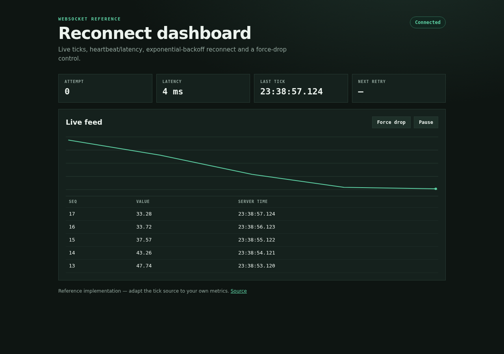

# Reconnect Dashboard — websocket reference

A small, dependency-light reference implementation of a **live websocket dashboard with robust reconnect**:

- exponential backoff (500 ms → 10 s cap) with attempt counter and next-retry countdown
- heartbeat ping/pong with round-trip latency
- force-drop button to demonstrate recovery
- pause/resume without a reconnect storm
- live table + sparkline, server health endpoint

The stack is deliberately minimal: `aiohttp` on the server, plain HTML/CSS/JS in the browser. Replace the tick source with your own metrics; the reconnect state machine in `public/app.js` is the reusable part.

## Run

```bash
python -m venv .venv && . .venv/bin/activate
pip install aiohttp
python server.py            # http://127.0.0.1:8765
```

`PORT=9000 python server.py` changes the port.

## Test

```bash
python test_smoke.py
```

Checks `/health`, receives a websocket tick, and verifies ping/pong.

## Screenshot



## Layout

- `server.py` — aiohttp app, `/ws` broadcast + ping/pong, `/health`, static files
- `public/index.html`, `public/style.css`, `public/app.js` — dashboard and reconnect state machine
- `test_smoke.py` — server/websocket smoke test

MIT licensed.
